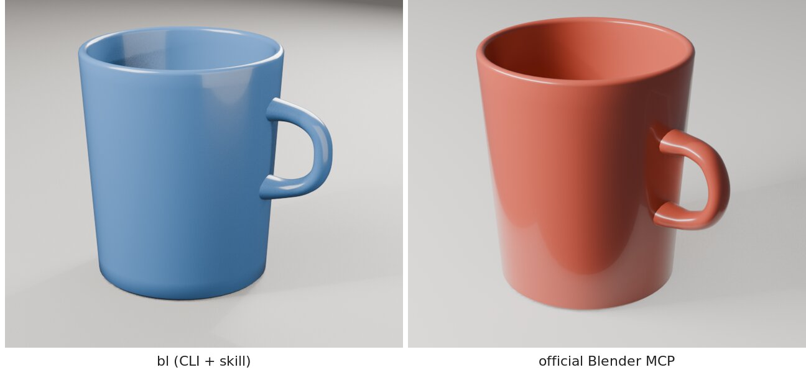
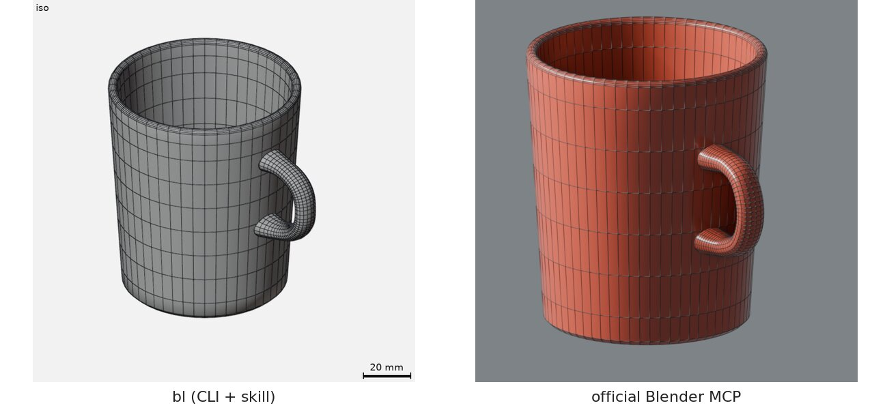

# bl — a Blender CLI for coding agents

`bl` lets an AI coding agent such as Claude Code drive Blender through a shell command instead of an MCP server. One headless Blender process per agent session keeps the scene open in the background, so each call takes milliseconds. Every script, image and version lands in a project folder, and quality checks return numbers instead of impressions.

It ships with a skill (`skill/blender/SKILL.md`) that teaches the agent a working loop: numbers first, then one image, then a before/after comparison with a measured change.



## Why a CLI instead of MCP?

We gave Claude Opus 5.5 the same modeling task (a coffee mug with exact dimensions, a blended handle, material, camera and lights) once with `bl` and once with the [official Blender MCP](https://projects.blender.org/lab/blender_mcp). Full method, images and caveats: **[docs/ab-test.md](docs/ab-test.md)**.

| | `bl` + skill (A2) | official MCP (B) |
|---|---|---|
| Model calls | **31** | 37 |
| Wall time | **4.4 min** | 6.2 min |
| Weighted tokens | **431k** (−22 %) | 553k |
| Output tokens | **24k** | 34k |
| Final mesh check (`bl qa --profile render`) | **0 warnings** | 3 warnings (zero-length edges, duplicate vertices) |
| RAM, Blender side (mean) | **~0.5 GB** (headless) | ~1.2 GB (GUI + X server) |



What we learned:

- **Turns cost tokens, not tool output.** Every model call re-reads the whole context, so one extra turn costs far more than a verbose tool reply. Our first skill version used *more* tokens than the MCP (750k). The 22 % saving came from rewriting the skill: batch related commands into one shell call, read all new images in one turn, and use the image critic only on request.
- **MCP tool definitions are cheap now.** Claude Code loads MCP tool schemas on demand. The official MCP added only about 1.9k tokens at session start.
- **The RAM difference is headless vs. GUI Blender**, not CLI vs. MCP.
- **Built-in checks catch what the agent misses.** `bl qa` and `mesh_stats()` found seam defects that the MCP agent's own checks did not.

One run per variant, so treat the numbers as an indication, not a benchmark.

## Features

- **Persistent headless worker:** `bl run` executes Python in the open scene. Each script is copied into a numbered journal, and parameters are passed with `--set name=value`.
- **Projects and versions:** `bl project`, `bl version "label"` and `bl save` keep a tidy `vNNN_<label>/{blend,preview,export,measurements,scripts}` tree.
- **Seeing with evidence:** `bl look` renders a sheet (iso/front/right/top), a wireframe, a section cut, a closeup or the scene camera. Each image comes with a legend (mm per px) and a scale bar. `--compare` puts the version's start state next to the current state and reports the changed pixels in %. It warns when a change is barely visible.
- **Numbers:** `bl info` summarizes the scene. `mesh_stats()` and `bl.hits()` are available inside scripts. `bl qa --profile game|render|print` checks with [EL4CTEO/blender-skills](https://github.com/EL4CTEO/blender-skills) `qa_check` plus broken faces and a poly budget.
- **Offline API docs:** `bl docs bpy.types.Object.matrix_world` gives the signature and description matching Blender 5.2, from the official MCP's documentation data.
- **Safety nets:** `bl` refuses to drop unsaved runs and auto-saves when the idle timeout ends the worker. Exit codes are stable: 0 ok, 1 finding, 2 script error, 3 worker/Blender.

## Quick start

```bash
bl doctor                              # check Blender, GPU, storage, dependencies
bl project mug                         # create/select a project (creates v001_start)
bl run build_mug.py --set r=41 --report
bl look --sheet                        # iso/front/right/top in one image
bl version "rounder lip"               # new version; the open scene is saved into it
bl run -e 'obj("Mug").modifiers["Bevel"].width = 0.002' --name lip
bl look --compare --focus 0,41,95 --radius 10   # before/after closeup + change in %
bl qa --profile render
bl save
```

Inside scripts these are available without imports: `bpy`, `obj(name)`, `report(obj)`, `mesh_stats(obj)`, `args` (from `--set`), `Vector`, `Matrix`, `math`, and `bl` (helper library, e.g. `bl.hits((x, y, z), direction)` returns ray hits in mm). Set `result = {...}` to return JSON.

## Install

Requirements: Linux, the official Blender 5.2 archive from blender.org (it bundles Python), git. A GPU is optional and only used for Cycles.

```bash
git clone https://github.com/<owner>/blender-tools && cd blender-tools
# optional machine config, read by bin/bl and tools/install.sh:
mkdir -p ~/.config/bl && cat > ~/.config/bl/env <<'EOF'
export BL_BLENDER_DIR=/opt/blender-5.2.4-linux-x64   # else `blender` on PATH
export BL_ROOT=$HOME/blender-projects                 # where projects live (default)
export BL_DOCS_SRC=$HOME/src/blender_mcp              # official MCP checkout @ dbbf836, for `bl docs`
EOF
bash tools/install.sh                  # Pillow + docutils into .deps/, docs data, symlink ~/bin/bl
bl doctor
```

`bl qa` uses `qa_check.py` from [EL4CTEO/blender-skills](https://github.com/EL4CTEO/blender-skills). By default it is looked up in `~/repos/blender-skills`; set `BL_QA_DIR` to point elsewhere.

Other variables: `BL_SESSION` (worker per session; defaults to `default`), `BL_IDLE` (idle timeout in s, default 900).

### Use with Claude Code

- Copy or symlink `skill/blender` to `~/.claude/skills/blender`.
- Optional blind image critic: symlink `agents/bl-critic.md` into `~/.claude/agents/`.

The skill tells the agent when to use which command.

## Tests

```bash
"$BLENDER_PY" -m unittest tests/test_bl.py   # Blender's bundled python
bash tests/selftest.sh                       # end-to-end against a real worker
```

## License

GPL-3.0-or-later (see `LICENSE`). `vendor/bl_bridge` and `vendor/bl_docs` are taken from the [official Blender MCP](https://projects.blender.org/lab/blender_mcp) (GPL-3.0-or-later); see their `VENDOR.md`.
