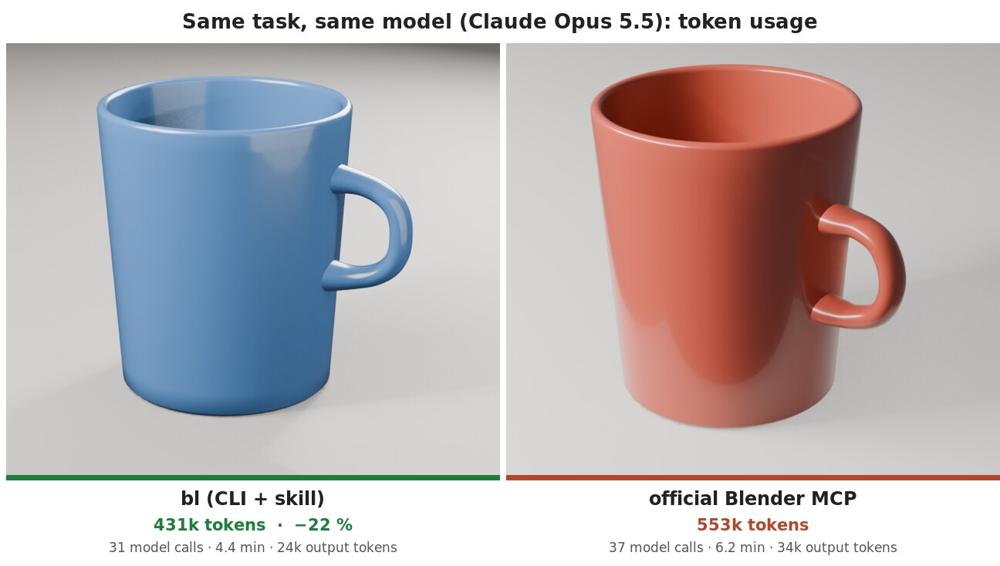
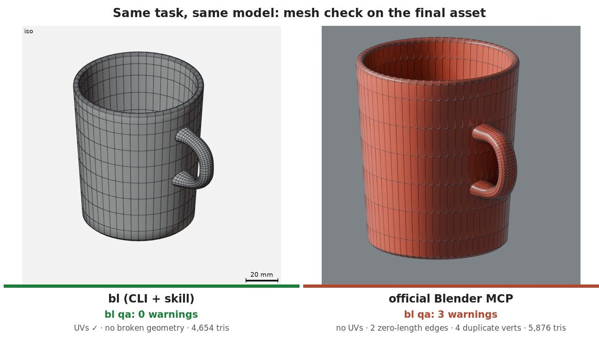

# A/B test: `bl` vs. the official Blender MCP

Same task, same model, same machine. One run per variant, so expect some noise.

## Setup

- **Task:** model a coffee mug as a clean low/mid-poly asset. Outer diameter 82 mm at the top and 70 mm at the bottom, height 95 mm, wall 3.5 mm, base 6 mm, rounded lip, chamfered foot, closed handle with a 10 × 7 mm cross-section and 22 mm inner height. The handle must blend into the wall without floating or poking into the inside. Add a ceramic material, a camera and lights for an EEVEE render, then write a report with paths, measurements, an image log and a self-assessment.
- **Model:** Claude Opus 5.5 in Claude Code, one agent per variant, each in its own empty directory.
- **A:** `bl` + skill `blender` + blind critic subagent (`bl-critic`), first version of the skill.
- **A2:** like A, with the revised skill: fewer turns, critic only on request.
- **B:** the official Blender MCP ([projects.blender.org/lab/blender_mcp](https://projects.blender.org/lab/blender_mcp), commit `dbbf836`) as shipped. Blender 5.2.4 runs with its GUI on a headless X server, which is how the MCP is meant to be used. MCP tools are loaded on demand (tool search).
- All variants had the same set of generic Blender knowledge skills available.
- **Measurements:**
  - Tokens are read from the session logs (main agent + subagents). "Weighted" is the input-token equivalent: cache read × 0.1, cache write × 1.25, output × 5.
  - RAM is the PSS of each variant's processes, sampled every 5 s.
  - Quality is checked identically on all final `.blend` files with `bl info` and `bl qa --profile render`.

## Results

Each image is the agent's own final render or wireframe from its run, with the handle seam in view. The renders were not re-done afterwards.

| | A (`bl`, first skill) | **A2 (`bl`, revised skill)** | B (official MCP) |
|---|---|---|---|
| Model calls | 49 + 3 critic runs | **31** | 37 |
| Wall time | 6.9 min | **4.4 min** | 6.2 min |
| Context at start / end | 45k / 116k | 45k / 98k | 47k / 113k |
| Output tokens | 41k | **24k** | 34k |
| **Weighted tokens** | 750k | **431k** | 553k |
| Images viewed by the agent | 23 | 15 | 11 |
| `bl qa --profile render` | pass, 1 warning (no UVs) | **pass, 0 warnings** | pass, 3 warnings: no UV map, 2 zero-length edges and 4 duplicate vertices at the boolean seam (the last two missed by the agent's own checks) |
| Final mesh: tris / n-gons | – | 4,654 / 26 | 5,876 / 27 |
| RAM, Blender side (mean / peak) | 533 / 659 MB | – | 1176 / 1466 MB |

All three mugs meet the dimensions within about 0.2 mm and look comparable. None of them has a true fillet where the handle meets the wall, and both A2 and B have about 26 n-gons along the boolean seam of the handle.

## What the numbers say

- **Tokens:** Every model call re-reads the whole context, about 80k tokens on average here. One extra call costs about 8k weighted tokens, so the number of turns matters far more than how verbose a tool is.
  - The first `bl` run (A) was 35 % *more* expensive than the MCP. The cause was 12 extra turns and three critic rounds, not the CLI: `bl` output is 100–1900 characters per call.
  - With the revised skill, A2 used 22 % fewer weighted tokens than the MCP. The revision batches related commands into one shell call, reads all new images in one turn, and calls the critic only on request.
- **Tool definitions:** The MCP's 26 tools add only about 1.9k tokens at session start, because Claude Code loads tool schemas on demand. "MCP bloats the context" no longer holds by itself.
- **RAM:** The difference is headless Blender (`bl`) versus Blender with a GUI plus an X server (MCP). The MCP server process itself uses about 55 MB. The official MCP also has a background mode, which was not tested here.
- **Quality:** `bl qa` caught mesh defects that the MCP agent's hand-written checks missed. A2 also found one of its own mistakes by measuring: the inner handle height was only 19 mm, and it fixed that before finishing.
- **Blind critic:** In run A it reported nothing that the `--compare` percentage or the agent had not already found, and one of its suggestions led to a worse version. It cost about 10 % of the run. It is now opt-in.

## Caveats

- One run per variant; agent runs vary.
- B used the MCP as shipped, without a workflow skill comparable to ours. The comparison is "this CLI + skill" against "the MCP out of the box", not CLI against MCP under otherwise equal conditions.
- All three agents rendered the first camera image overexposed. They chose key lights of 40–60 W at about 0.5 m for a 10 cm object, then reduced them by about 4×. This is the next thing `bl` should handle.
